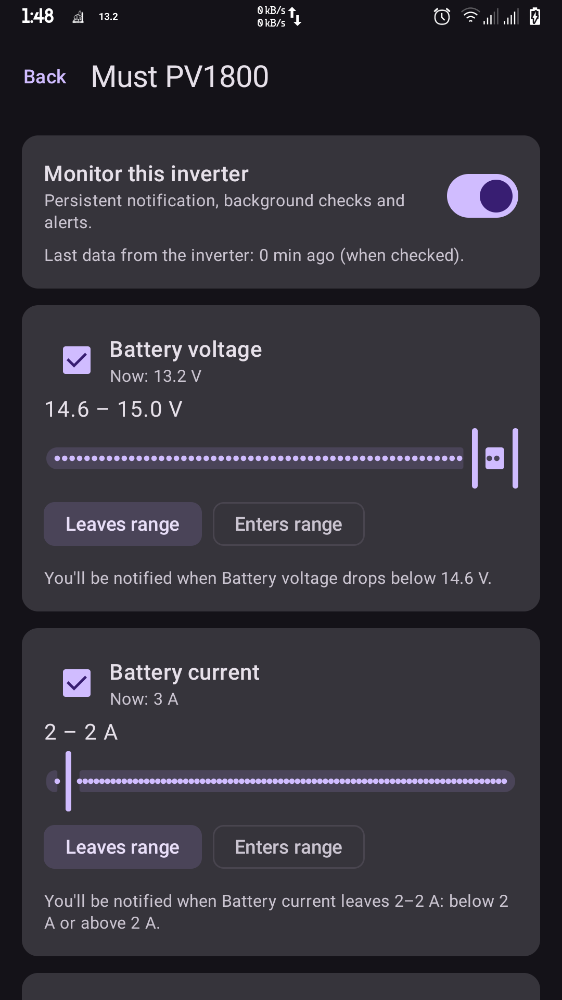
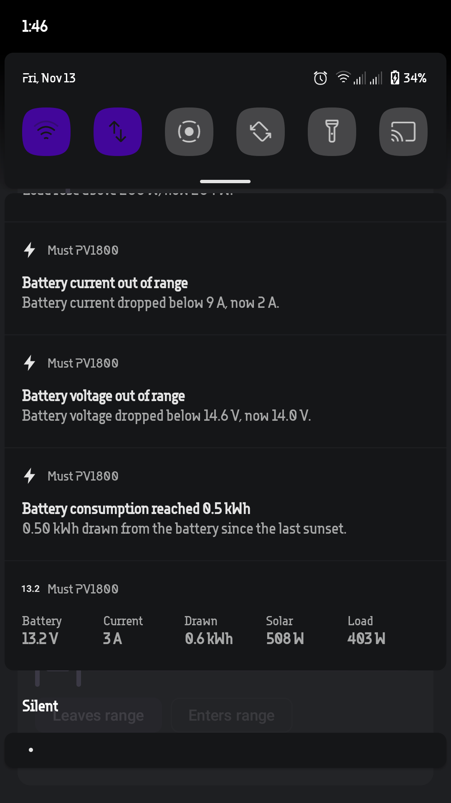

# MustNotify

[](LICENSE)
[](#platforms)
[](https://www.jetbrains.com/help/kotlin-multiplatform-dev/get-started.html)
[](#status)

**MustNotify** is a free, open-source monitor for **MUST solar inverters** (observed with a **PV1800**, working against the same cloud the vendor app uses). It polls your inverter every few minutes, shows its live values, and sends a notification whenever a parameter crosses a threshold **you** set with sliders — for example *"notify me when battery voltage drops below 12.2 V"* or *"tell me when the battery has drawn 0.5 kWh tonight"*.

The vendor's app (SmartValue) shows you a dashboard; MustNotify watches it for you and only speaks up when something matters.

---

## Features

- **Threshold alerts with sliders** — for each inverter, set a range for:
  - Battery voltage (9–15 V)
  - Battery current (0–80 A)
  - Solar power and Load power (0 W up to the inverter's rated power + 10 %, read from the device when available)
  - Each rule can notify on **enter** or on **leave**, and a plain-language hint under the sliders tells you exactly what the rule will do after you enable it.
- **Night-consumption budget** — get one alert when the battery discharge counter has grown by your budget (up to 10 kWh) since the last sunset. The baseline moves up automatically at sunset (solar ≤ 50 W for 30 minutes), so it measures *tonight's* usage, not the lifetime total.
- **Live status notification** (Android) — one persistent, silent notification per monitored inverter with battery voltage/current, energy drawn, solar and load power.
- **Self-aware polling** — the poller aims just after the inverter's ~5-minute data refresh, backs off on failures (never alerting on mere offline-ness), and if the device data goes stale (> 15 minutes old) it pauses thresholds and tells you once.
- **Runs after reboot** (Android) — a foreground service with a boot receiver keeps monitoring alive; a wake lock keeps the timer on schedule.
- **Desktop companion** — the same UI and alert engine run as a desktop (JVM) app while it is open.

## Screenshots

| Alerts configuration | Notifications |
| --- | --- |
|  |  |

## How it works

1. You sign in with your **existing SmartValue account** and pick one or more of your inverters to monitor.
2. MustNotify polls the cloud directly over HTTPS (~every 5 minutes, timed to the inverter's own reporting cycle).
3. Each poll is evaluated against your rules in a small, pure, unit-tested engine (`core`), which tracks transitions and baselines between polls.
4. Anything worth saying becomes a notification; anything else updates the live status quietly.

The vendor cloud protocol was reverse-engineered from observed traffic of the vendor app: the login password is sent as a lowercase SHA-1 hex digest, readings are fetched with device identifiers, and today the readings endpoint needs no session token (the app still handles a future auth requirement). See [`docs/ARCHITECTURE.md`](docs/ARCHITECTURE.md) for the full picture and [`docs/PRIVACY.md`](docs/PRIVACY.md) for what leaves your device.

## Platforms

| Platform | Status | Notes |
| --- | --- | --- |
| **Android** | ✔ Working (Testing) | Foreground service, persistent status notification, boot restart, Keystore-encrypted login token. |
| **Desktop (Windows / macOS / Linux)** | ✖ Alerts not implemented yet, WIP UI | Same Compose UI and alert engine; runs in a window and must stay open. (would appreaciate PRs especially for distribution)|
| iOS | ✖ Not planned | Background polling is not reliable on iOS without push infrastructure. |

## Roadmap

- [x] Observe traffic of vendor app
- [x] Implement logic and UI
- [x] Implement android alerts and live notifications
- [x] Release first `Alpha` build
- [x] Implement android home-screen widget
- [x] Design and replace app icon
- [ ] Device-screen polish: back-arrow icon, tappable parameter cards, clearer monitoring label
- [ ] Hint text: one consistent "rises above / drops below" style everywhere; discharge hint expressed in kWh and Wh
- [ ] Color-coded live values on screen (freshness of "X min ago", themed "Now: …" values)
- [ ] In-app battery-optimization prompt on Android, instead of sending the user to Settings
- [ ] Separate notification channel for the persistent status notification, so it never mixes with alerts
- [ ] Color-coded values in the status notification (battery voltage, current, solar, load, drawn energy)
- [ ] Desktop: refresh readings right after login and device pick, without re-entering the app
- [ ] Desktop: system notifications plus tray/status-bar live monitoring
- [ ] Native packages: executables for Linux (Arch, Ubuntu) and Windows
- [ ] Sign-in and add inverters from multiple accounts into a single list (maintenance-technician friendly)
- [ ] Export-logs button with sensitive data (PN, SN, token, …) obfuscated

## Building from source

The project uses the **[Kotlin Toolchain](https://kotlin-toolchain.org/dev/)** (Amper-style `module.yaml`/`project.yaml` instead of Gradle). The `kotlin` / `kotlin.bat` scripts in the repository root are self-bootstrapping: on first use they download the pinned toolchain, so no separate install is required.

```bash
./kotlin build                 # build everything
./kotlin test                  # run all tests
./kotlin run -m desktopApp     # run the desktop app
./kotlin run -m androidApp     # install/launch the Android app (needs the Android SDK)
```

For details — module layout, the `src@<platform>` convention, signing, and IDE setup — see [`docs/BUILDING.md`](docs/BUILDING.md).

## Project structure

```
├── core/                  Shared engine: vendor cloud API client, snapshot parsing,
│                          threshold rules, poll engine/loop, JSON settings store
│   └── src@android|jvm/   Platform bits (file storage, SHA-1)
├── app/
│   ├── shared/            Compose Multiplatform UI: login, device list, per-inverter screen
│   ├── androidApp/        Foreground MonitorService, notifier, Keystore secret store, boot receiver
│   └── desktopApp/        Desktop entry point (JVM)
├── assets/screenshots/
└── docs/
```

## Documentation

- [`docs/ARCHITECTURE.md`](docs/ARCHITECTURE.md) — modules, data flow, the polling schedule, and the alert rules in detail.
- [`docs/PRIVACY.md`](docs/PRIVACY.md) — exactly what data the app handles, sends, and stores; permissions explained.
- [`docs/BUILDING.md`](docs/BUILDING.md) — prerequisites, commands, module conventions, tests.
- [`docs/TROUBLESHOOTING.md`](docs/TROUBLESHOOTING.md) — notifications not arriving, battery optimization, stale data, and more.

## Status & limitations

- **Alpha** (`0.1.0-alpha1`): expect rough edges; settings may reset across incompatible versions.
- The vendor cloud API is undocumented and could change at any time; if it starts enforcing authentication or changes endpoints, the app may stop working until it is updated.
- Android restricts background work: monitoring depends on the app not being killed by aggressive battery managers (see [troubleshooting](docs/TROUBLESHOOTING.md)). WorkManager's 15-minute floor is exactly why MustNotify uses a foreground service instead.
- Only the first page of the account's device list is fetched (20 devices).

## Privacy

No analytics, no ads, no Firebase/FCM, no third-party SDKs. The app talks only to the vendor cloud over HTTPS, stores your login token encrypted with a non-exportable Android Keystore key, never logs credentials or device identifiers, and disables backup and cleartext traffic. Full details in [`docs/PRIVACY.md`](docs/PRIVACY.md).

## Disclaimer

This is an **unofficial community project** and is not affiliated with, endorsed by, or connected to MUST Power or its cloud provider. Use it at your own risk; the vendor's terms of service may restrict third-party access to their cloud. Always rely on the vendor's own tools for safety-critical monitoring.

## Contributing

Bug reports and feature requests are welcome — please use the [issue templates](.github/ISSUE_TEMPLATE/bug_report.yml). When reporting a bug, include your inverter model, platform and app version, and **never** paste your password, login token or serial numbers.

## License

Released under the [GNU General Public License v3.0](LICENSE).
